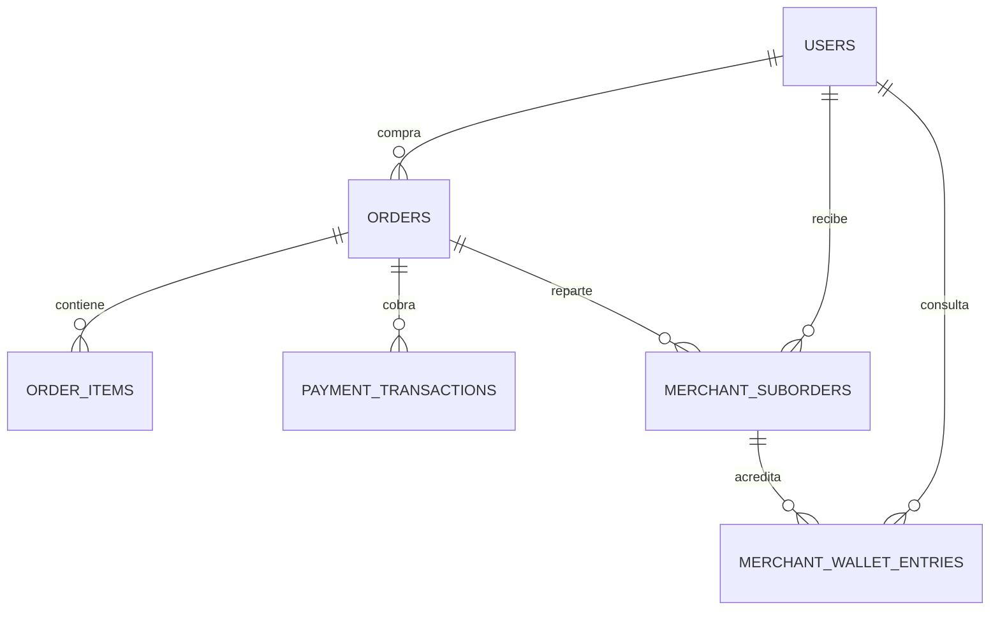

# Pagos y liquidación multivendedor

## Modelo

`orders` representa la orden general del cliente y conserva una sola referencia, importe y transacción Wompi. `payment_transactions` registra el evento de Wompi con `transaction_id` único para procesar reintentos de forma idempotente.

Al confirmarse el pago, `merchant_suborders` genera una suborden hija por vendedor, con referencia propia, snapshot de sus ítems y montos en centavos para bruto, comisión y neto. Esos valores quedan congelados aunque luego cambie la comisión configurada. `merchant_wallet_entries` es el libro mayor: cada acreditación es un crédito con clave idempotente única. El saldo es la suma de créditos menos débitos.

## Regla de liquidación

- Solo se crean subórdenes y se acredita el saldo si el webhook autenticado confirma `APPROVED` y el monto y la moneda coinciden con el pedido.
- Los importes se manejan en centavos enteros. El subtotal pagado de productos (subtotal menos descuento por puntos) se distribuye proporcionalmente a cada comerciante; los centavos residuales se asignan de forma determinística.
- La comisión conserva la tasa que quedó reflejada en `orders.commission_amount`; cada asignación guarda sus propios importes brutos, comisión y neto.
- El costo de envío no se acredita a los vendedores en esta regla y permanece en la plataforma. El descuento por puntos se distribuye proporcionalmente entre los vendedores.
- La exportación administrativa incluye subórdenes `available` y datos de destino registrados para que el administrador realice las transferencias. La exportación no marca el dinero como pagado ni reduce el saldo; registrar desembolsos y conciliarlos requiere una operación administrativa de pago con comprobante.

## Integración

El checkout de pedidos usa las credenciales centrales `WOMPI_PUBLIC_KEY`, `WOMPI_INTEGRITY_SECRET` y `WOMPI_EVENTS_SECRET`. Las credenciales Wompi individuales guardadas en perfiles de vendedores no se usan para cobrar órdenes. La ruta autenticada de webhook sigue siendo `POST /api/webhooks/wompi` y delega el procesamiento en `OrderPaymentService`.

Ejecutar la nueva migración con `php artisan migrate`. El comercio consulta el saldo y sus movimientos en Finanzas. El administrador descarga el archivo de dispersión en `/admin/settlements/export`.
